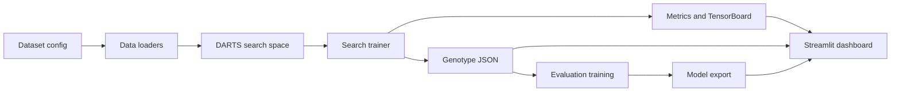
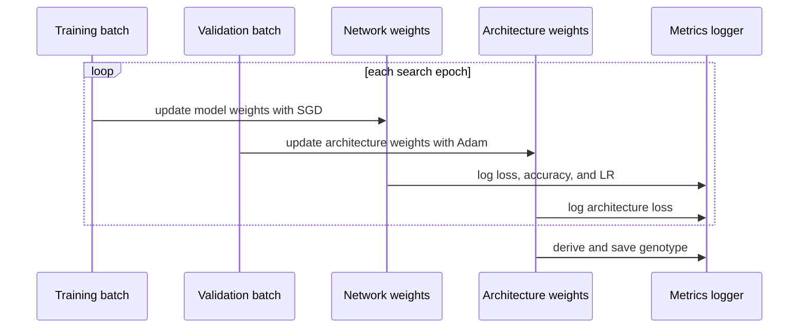
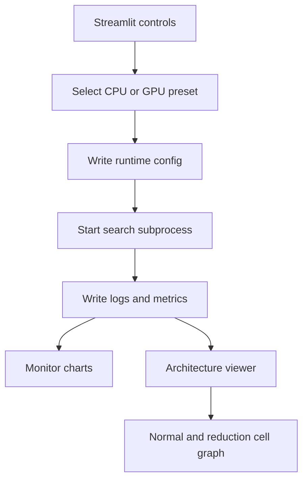
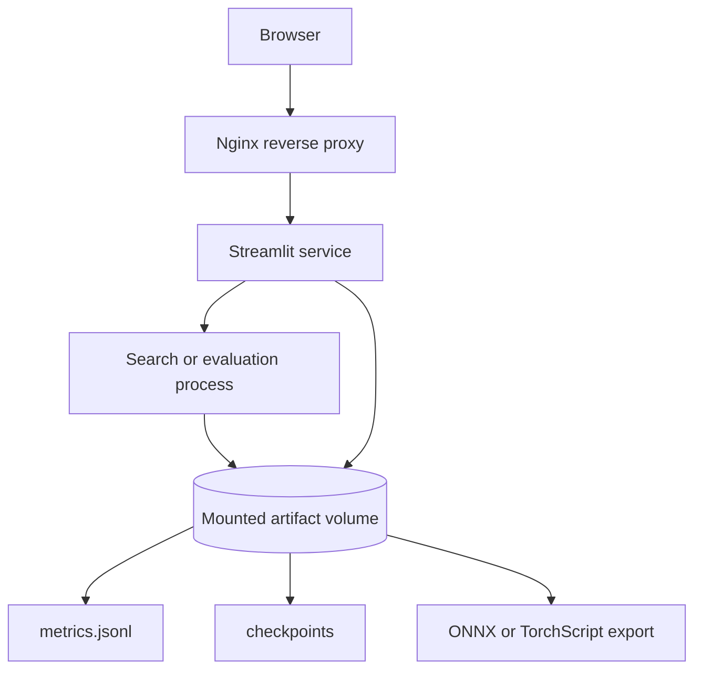
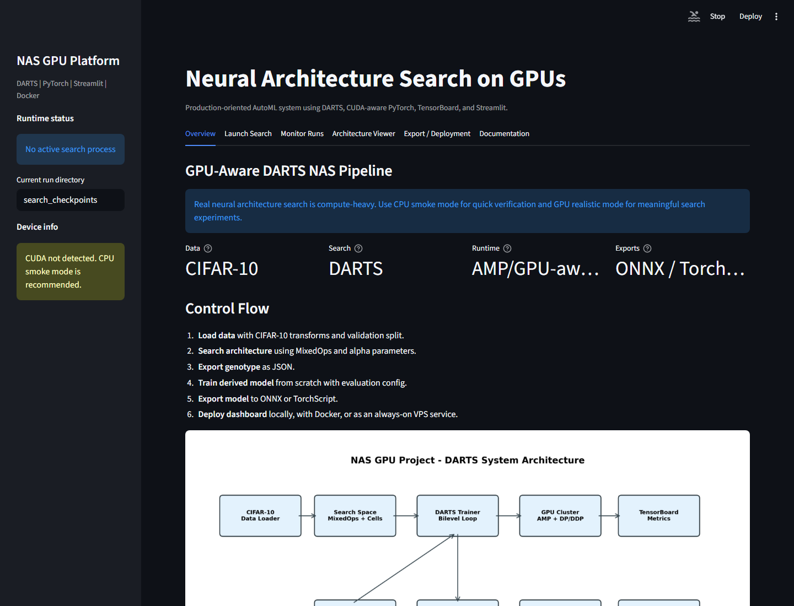
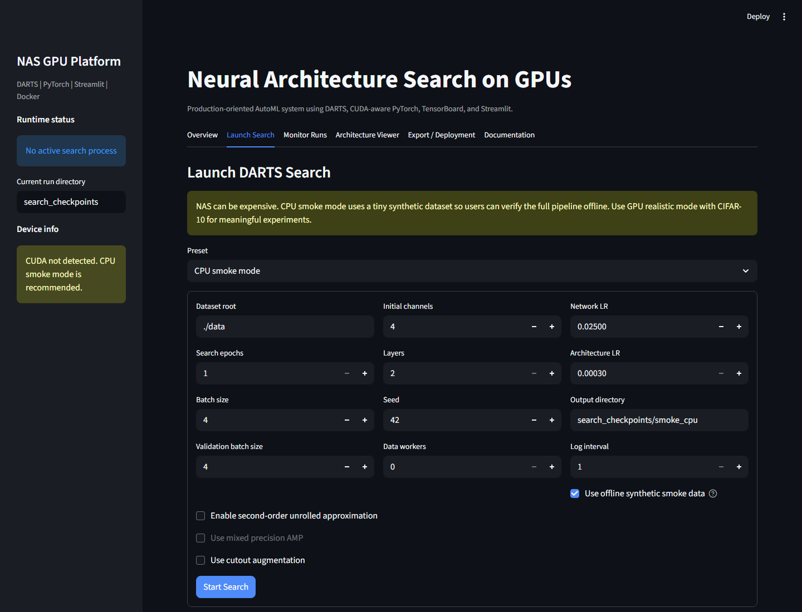
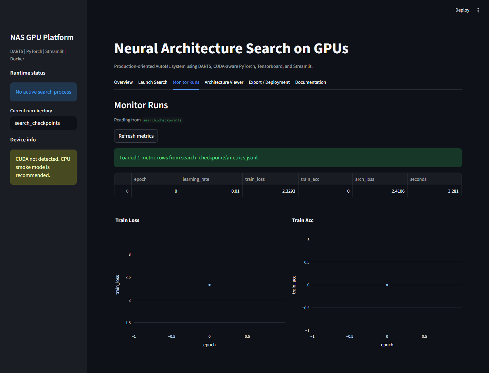
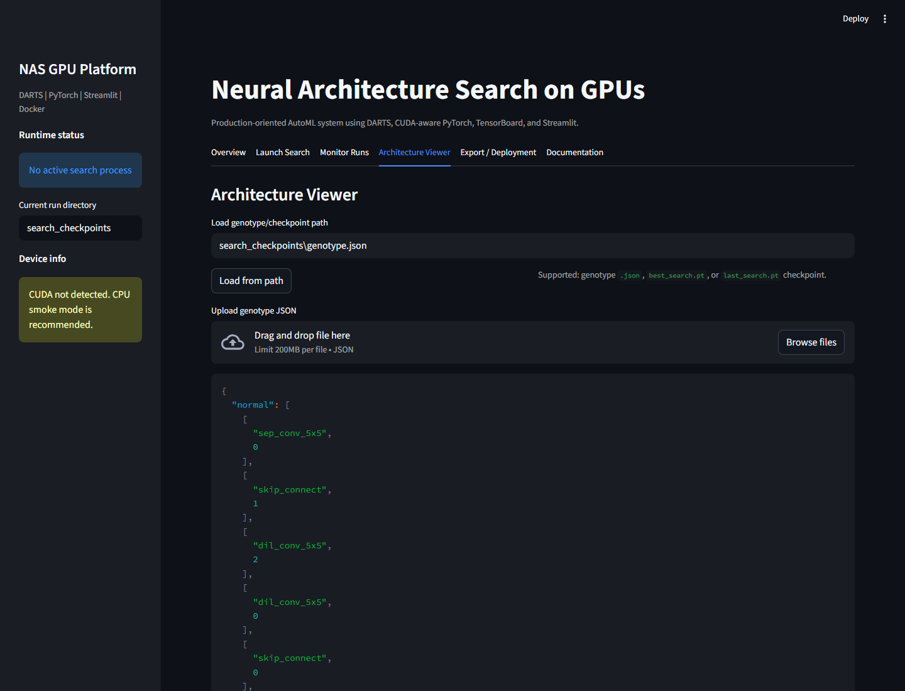

# Neural Architecture Search on GPUs

[](https://github.com/HUSNAIN-MUNAWAR/Neural-Architecture-Search-NAS-on-GPUs/actions/workflows/ci.yml)


[](#quick-start)
[](#workflow-diagrams)
[](docs/BENCHMARKS.md)
[](docs/project_report.pdf)

GPU-aware Neural Architecture Search platform for image classification research and deployment-oriented ML engineering. The repository implements a DARTS-style search loop in PyTorch, exports discovered genotypes, evaluates derived networks, and exposes the workflow through a Streamlit dashboard, Docker runtime, tests, CI, and reproducibility documentation.

The goal is practical: reduce manual CNN architecture trial-and-error while keeping every experiment inspectable through configs, logs, metrics, checkpoints, and exported artifacts.

---

## Review Snapshot

| Area | Evidence |
|---|---|
| NAS implementation | DARTS mixed operations, architecture parameters, normal/reduction cells, genotype derivation |
| GPU-aware training | CUDA device selection, AMP support, pinned-memory dataloaders, DataParallel-aware wrapping |
| Experiment workflow | YAML configs, seeds, JSONL metrics, TensorBoard logging, checkpoint directories |
| Evaluation and export | Evaluation trainer, accuracy/loss reporting, ONNX export, TorchScript export |
| Demo interface | Streamlit control plane for launching runs, monitoring metrics, and viewing genotypes |
| Deployment path | Docker, Docker Compose, VPS/systemd, Nginx reverse-proxy example |
| Quality gates | Pytest suite, smoke test, verifier script, Ruff, Black, GitHub Actions CI |

---

## Workflow Diagrams

### End-to-End ML Workflow



### DARTS Optimization Loop



### Dashboard and Runtime Control



### Deployment Path



For deeper architecture notes, see [docs/ARCHITECTURE.md](docs/ARCHITECTURE.md).

---

## Application Screenshots

These screenshots were captured from the local Streamlit dashboard after running the offline CPU smoke search in `configs/smoke_cpu.yaml`. The monitor view shows the generated `metrics.jsonl`, and the architecture view loads the generated `genotype.json`.

### Overview



### Launch Search



### Monitor Runs



### Architecture Viewer



---

## Core Capabilities

- DARTS-style differentiable architecture search for image classification.
- CIFAR-10 data path with train/validation split and augmentation.
- Offline synthetic smoke mode for fast local and CI verification.
- First-order DARTS trainer with optional unrolled architecture update.
- CUDA-aware runtime with automatic mixed precision support.
- JSONL metrics and TensorBoard event logging.
- Genotype export for normal and reduction cells.
- Evaluation training for searched architectures.
- ONNX and TorchScript export for downstream deployment checks.
- Streamlit dashboard for launching, monitoring, and inspecting runs.
- Docker and VPS deployment examples.
- Unit tests, smoke tests, project verification, and GitHub Actions CI.

---

## Repository Structure

```text
Neural-Architecture-Search-NAS-on-GPUs/
|-- configs/                  # Search, evaluation, and smoke-run YAML configs
|-- data/                     # CIFAR-10 and synthetic dataloaders
|-- deployment/               # VPS, systemd, Nginx, and healthcheck assets
|-- docs/                     # Architecture, deployment, benchmark, and report docs
|-- evaluation/               # Train, evaluate, and export derived architectures
|-- examples/                 # Synthetic example metrics and genotype artifacts
|-- models/                   # DARTS operations, cells, search networks, genotypes
|-- scripts/                  # CLI entry points, smoke test, project verifier
|-- search/                   # DARTS trainer, architect update, search utilities
|-- streamlit_app/            # Dashboard and UI components
|-- tests/                    # Pytest coverage for core behavior
|-- utils/                    # Config, logging, GPU, and file helpers
|-- Dockerfile                # CUDA-oriented runtime image
|-- Dockerfile.cpu            # CPU/dashboard-friendly runtime image
|-- docker-compose.yml        # Local or VPS deployment
|-- docker-compose.gpu.yml    # GPU compose override
`-- pyproject.toml            # Package metadata and tool configuration
```

---

## Quick Start

### 1. Install locally

```bash
git clone https://github.com/HUSNAIN-MUNAWAR/Neural-Architecture-Search-NAS-on-GPUs.git
cd Neural-Architecture-Search-NAS-on-GPUs
python -m venv .venv
source .venv/bin/activate  # Windows: .venv\Scripts\activate
pip install --upgrade pip
pip install -r requirements.txt
```

### 2. Verify the project without GPU or dataset download

```bash
python scripts/smoke_test.py
python scripts/run_search.py --config configs/smoke_cpu.yaml
```

### 3. Run a GPU search on CIFAR-10

```bash
python scripts/run_search.py --config configs/demo_gpu.yaml
```

For a longer experiment:

```bash
python scripts/run_search.py --config configs/default_search.yaml
```

### 4. Evaluate a searched genotype

```bash
python scripts/run_evaluation.py \
  --config configs/default_eval.yaml \
  --genotype search_checkpoints/genotype.json
```

### 5. Launch the dashboard

```bash
streamlit run streamlit_app/app.py
```

Streamlit will print the local URL, usually `http://localhost:8501`.

---

## Streamlit Dashboard

The dashboard provides a compact operator view over the NAS workflow:

- Runtime status and environment checks.
- CPU smoke preset and GPU search preset.
- Custom config controls for search experiments.
- Non-blocking subprocess launch for training jobs.
- Live log and metrics review.
- TensorBoard scalar reader and Plotly curves.
- Genotype JSON loading and cell visualization.
- Export artifact discovery for ONNX and TorchScript outputs.

---

## Experiment Evidence

The repository separates smoke evidence from benchmark evidence:

| Artifact | Location | Purpose |
|---|---|---|
| Synthetic genotype example | [examples/smoke_genotype.synthetic.json](examples/smoke_genotype.synthetic.json) | Shows the genotype JSON schema |
| Synthetic metrics example | [examples/smoke_metrics.synthetic.jsonl](examples/smoke_metrics.synthetic.jsonl) | Shows the JSONL metrics format |
| Benchmark logbook | [docs/BENCHMARKS.md](docs/BENCHMARKS.md) | Place for measured GPU search and evaluation runs |
| Reproducibility notes | [docs/REPRODUCIBILITY.md](docs/REPRODUCIBILITY.md) | Seeds, configs, artifacts, and reporting expectations |
| Project report | [docs/project_report.pdf](docs/project_report.pdf) | Printable project summary |

Published accuracy numbers should be added only after a measured run with the commit hash, config, GPU model, CUDA version, metrics file, and genotype artifact.

---

## Testing and Verification

```bash
pytest
python scripts/smoke_test.py
python scripts/verify_project.py
```

The test suite covers operation shapes, search-space forward passes, genotype derivation, synthetic dataloaders, trainer smoke behavior, evaluation smoke behavior, import checks, and required repository files.

---

## Deployment

### Local service

```bash
streamlit run streamlit_app/app.py --server.address 0.0.0.0 --server.port 8501
```

### Docker

```bash
docker compose up -d --build
```

### GPU Docker runtime

```bash
docker compose -f docker-compose.yml -f docker-compose.gpu.yml up -d --build
```

GPU containers require a compatible NVIDIA driver and NVIDIA Container Toolkit on the host. Full VPS setup notes are in [deployment/vps/README.md](deployment/vps/README.md), and the broader deployment guide is in [docs/DEPLOYMENT.md](docs/DEPLOYMENT.md).

---

## Research Foundations

| Topic | Primary source | How it maps to this repository |
|---|---|---|
| Differentiable architecture search | [DARTS: Differentiable Architecture Search](https://arxiv.org/abs/1806.09055) | Continuous relaxation of operation choices and gradient-based architecture optimization |
| Cell-based transferable search | [Learning Transferable Architectures for Scalable Image Recognition](https://arxiv.org/abs/1707.07012) | Normal/reduction cell framing and CIFAR-to-larger-task search pattern |
| Target-task and hardware-aware NAS | [ProxylessNAS](https://arxiv.org/abs/1812.00332) | Motivation for direct search, hardware cost awareness, and deployment-minded NAS |
| Differentiable hardware-aware ConvNet design | [FBNet](https://arxiv.org/abs/1812.03443) | Differentiable search with latency-aware design considerations |
| Mixed precision runtime | [PyTorch AMP documentation](https://docs.pytorch.org/docs/stable/amp.html) | CUDA AMP support for faster and more memory-efficient training |
| Model export | [PyTorch ONNX documentation](https://docs.pytorch.org/docs/stable/onnx.html) | ONNX export path for deployment and interoperability checks |

---

## Configuration Surface

| Config | Intended use |
|---|---|
| [configs/smoke_cpu.yaml](configs/smoke_cpu.yaml) | Offline CPU smoke verification |
| [configs/demo_gpu.yaml](configs/demo_gpu.yaml) | Short CUDA-backed demonstration run |
| [configs/default_search.yaml](configs/default_search.yaml) | Longer DARTS search run |
| [configs/default_eval.yaml](configs/default_eval.yaml) | Evaluation training for exported genotype |

---

## Limitations

- CIFAR-10 is the default real dataset path; custom datasets need a dataloader adapter.
- Synthetic smoke runs validate execution paths and artifact formats, not model quality.
- The current multi-GPU path is DataParallel-aware; production DDP should be validated separately before using it for distributed training claims.
- Benchmark results depend on hardware, CUDA version, training budget, seed, and exact config.

---

## Roadmap

- NAS-Bench-201 benchmark adapter.
- Optuna or Ray Tune integration for search-space experiments.
- MLflow or Weights & Biases tracking backend.
- FastAPI service for remote job control.
- Queue-based execution with Redis/Celery.
- Dataset adapter template for industrial image classification.
- DDP training path with documented multi-GPU validation.
