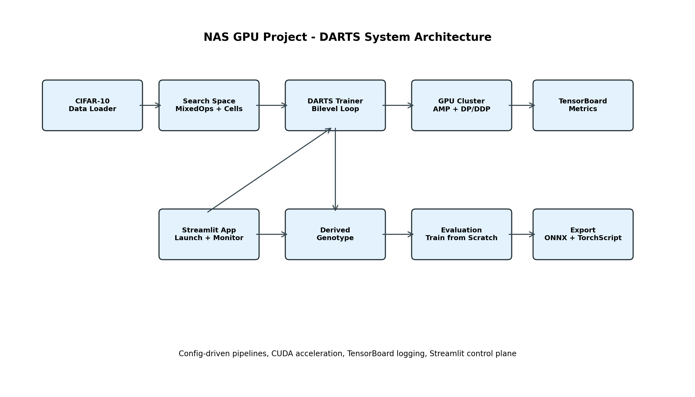

# Neural Architecture Search on GPUs

[](https://github.com/husnainbinmunawar/Neural-Architecture-Search-NAS-on-GPUs/actions/workflows/ci.yml)


**GPU-Accelerated Neural Architecture Search Platform using DARTS, PyTorch, Streamlit, Docker, and MLOps practices.**

This repository demonstrates how to turn neural architecture search from a research idea into a reproducible ML engineering workflow: configurable data loading, DARTS-style search, GPU-aware training, experiment logs, a Streamlit control plane, model export, Docker deployment, tests, CI, and honest documentation.

**Business value in one line:** it reduces manual CNN trial-and-error for image classification projects and produces inspectable architecture artifacts that can be evaluated, exported, and adapted to real client datasets.

> **Honest scope:** this is a production-oriented portfolio/research implementation, not a claim of state-of-the-art CIFAR-10 accuracy. Benchmark tables are intentionally blank until a real GPU run is performed and logged.

---

## 30-Second Review

| What a reviewer sees | Evidence in this repo |
|---|---|
| AutoML / NAS engineering | DARTS MixedOps, architecture parameters, genotype export, normal/reduction cells |
| Real PyTorch training structure | separate data, search, evaluation, export, config, logging, and utility modules |
| GPU readiness | AMP support, CUDA device selection, pinned-memory loaders, DataParallel-aware model wrapping |
| Reproducibility | YAML configs, seeds, JSONL metrics, TensorBoard logs, smoke tests, verification script |
| Client-facing delivery | Streamlit dashboard, Docker Compose, VPS/systemd/Nginx deployment docs |
| Honest reporting | benchmark template only; no fake accuracy, fake screenshots, or fake production claims |

---

## Architecture Diagram



```text
Data pipeline -> Search space -> DARTS trainer -> Genotype export -> Evaluation training -> ONNX/TorchScript export -> Streamlit control plane
```

---

## Problem Statement

Designing CNN architectures manually is expensive. Engineers often test many combinations of convolution blocks, kernel sizes, skip connections, channel widths, and training recipes. Neural Architecture Search helps automate part of this process by learning architecture choices from data. DARTS makes NAS practical by relaxing discrete operation choices into differentiable architecture weights, so architecture search can be optimized with gradients instead of brute-force enumeration.

---

## What This Project Demonstrates

- DARTS-style differentiable architecture search for image classification.
- Modular PyTorch code with clean separation of data, search, evaluation, export, and UI layers.
- GPU-aware execution with CUDA detection, AMP, pinned-memory dataloaders, and DataParallel-aware wrapping.
- Offline synthetic smoke mode for CI and demos without downloading CIFAR-10.
- CIFAR-10 training/search path for real experiments.
- TensorBoard and JSONL metrics for monitoring.
- Streamlit dashboard for launching searches, checking logs, viewing metrics, and inspecting genotype JSON.
- ONNX and TorchScript export paths for deployment-oriented handoff.
- Docker, Docker Compose, VPS/systemd, and Nginx deployment examples.
- Pytest, smoke tests, project verification, and GitHub Actions CI.

---

## Feature Status

| Feature | Status | Why it matters to clients/employers |
|---|---:|---|
| CIFAR-10 data pipeline | Implemented | Shows real image loading, augmentation, validation split, and GPU-friendly dataloaders. |
| Offline synthetic smoke mode | Implemented | Lets reviewers verify the project without internet, GPU, or dataset downloads. |
| DARTS search space | Implemented | Demonstrates AutoML search-space engineering and differentiable operation selection. |
| First-order DARTS trainer | Implemented | Shows separate network-weight and architecture-weight optimization. |
| Optional unrolled architecture update | Implemented, research baseline | Useful for experimentation; should be profiled before large runs. |
| AMP mixed precision | Implemented | Improves speed/memory behavior on CUDA hardware. |
| Multi-GPU awareness | DataParallel-aware | Suitable for extension; full production DDP must be validated on target hardware before claiming support. |
| TensorBoard + JSONL metrics | Implemented | Enables monitoring and reproducible experiment review. |
| Streamlit dashboard | Implemented | Provides a non-blocking local control plane for demos and client review. |
| Genotype visualization | Implemented | Makes NAS outputs easier to understand. |
| ONNX / TorchScript export | Implemented | Bridges model training to deployment workflows. |
| Docker / Compose | Implemented | Makes local and VPS deployment repeatable. |
| CI and smoke checks | Implemented | Protects core functionality from breaking changes. |
| Benchmarks | Template only | Real numbers must be added only after measured GPU runs. |

---

## Tech Stack

| Area | Tools |
|---|---|
| Deep learning | PyTorch, torchvision |
| AutoML / NAS | DARTS-style differentiable architecture search |
| Dataset | CIFAR-10 by default, synthetic offline smoke dataset for checks |
| GPU acceleration | CUDA, AMP, CuDNN benchmark, pinned memory |
| Monitoring | TensorBoard, JSONL metrics, Plotly |
| UI | Streamlit |
| Config | YAML, typed dataclasses |
| Testing | pytest, smoke tests, verification script |
| Deployment | Docker, Docker Compose, systemd, Nginx examples |
| Model export | ONNX, TorchScript |
| Code quality | Ruff, Black, pytest config via `pyproject.toml` |

---

## Repository Structure

```text
Neural-Architecture-Search-NAS-on-GPUs/
├── configs/                  # Search/evaluation/demo YAML configs
├── data/                     # CIFAR-10 and synthetic dataloaders
├── deployment/               # VPS, systemd, Nginx, healthcheck assets
├── docs/                     # Markdown docs, architecture diagrams, PDF report
├── evaluation/               # Train/evaluate/export derived architectures
├── models/                   # DARTS operations, cells, and networks
├── scripts/                  # CLI entry points, smoke test, verifier
├── search/                   # DARTS trainer, architect, genotype utilities
├── streamlit_app/            # Dashboard and UI components
├── tests/                    # Unit and smoke tests
├── utils/                    # Config, logging, GPU, and file helpers
├── Dockerfile                # CUDA-enabled runtime
├── Dockerfile.cpu            # CPU/dashboard-friendly runtime
├── docker-compose.yml        # Always-on local/VPS deployment
├── docker-compose.gpu.yml    # GPU runtime compose override
└── pyproject.toml            # Project metadata and tooling config
```

---

## Quick Start

### 1. Install locally

```bash
git clone https://github.com/husnainbinmunawar/Neural-Architecture-Search-NAS-on-GPUs.git
cd Neural-Architecture-Search-NAS-on-GPUs
python -m venv .venv
source .venv/bin/activate  # Windows: .venv\Scripts\activate
pip install --upgrade pip
pip install -r requirements.txt
```

### 2. Verify without GPU or dataset download

This is the fastest reviewer/client check. It uses synthetic CIFAR-shaped tensors and does **not** claim accuracy.

```bash
python scripts/smoke_test.py
python scripts/run_search.py --config configs/smoke_cpu.yaml
```

### 3. GPU search run on CIFAR-10

```bash
python scripts/run_search.py --config configs/demo_gpu.yaml
```

For a longer search:

```bash
python scripts/run_search.py --config configs/default_search.yaml
```

### 4. Evaluation run

```bash
python scripts/run_evaluation.py \
  --config configs/default_eval.yaml \
  --genotype search_checkpoints/genotype.json
```

### 5. Launch Streamlit dashboard

```bash
streamlit run streamlit_app/app.py
```

Open the displayed local URL, usually `http://localhost:8501`.

### 6. Docker launch

```bash
docker compose up --build
```

For GPU containers with NVIDIA Container Toolkit:

```bash
docker compose -f docker-compose.yml -f docker-compose.gpu.yml up -d --build
```

---

## GPU Setup Notes

- Install a compatible NVIDIA driver on the host.
- Install a PyTorch build that matches the CUDA runtime you want to use.
- For Docker GPU support, install NVIDIA Container Toolkit and verify:

```bash
docker run --rm --gpus all nvidia/cuda:12.1.0-base-ubuntu22.04 nvidia-smi
```

The project can run smoke checks on CPU, but meaningful NAS experiments should be run on CUDA GPUs.

---

## Streamlit Dashboard

The dashboard includes:

- **Overview**: concise pipeline explanation and runtime status.
- **Launch Search**: CPU smoke preset, GPU realistic preset, custom config controls, non-blocking subprocess start.
- **Monitor Runs**: live log viewer, JSONL metrics, TensorBoard scalar reader, Plotly curves.
- **Architecture Viewer**: load genotype JSON or checkpoint and render normal/reduction cells.
- **Export / Deployment**: download genotype, metrics, logs, ONNX/TorchScript artifacts when available.
- **Documentation**: local docs and deployment guide preview.

Real NAS jobs run as a subprocess so the Streamlit UI does not block during training.

---

## Deployment

### Local

```bash
streamlit run streamlit_app/app.py --server.address 0.0.0.0 --server.port 8501
```

### Docker

```bash
docker compose up -d --build
```

### VPS always-on

Use Docker Compose or systemd on Ubuntu:

```bash
docker compose up -d --build
```

For systemd deployment, see [`deployment/vps/README.md`](deployment/vps/README.md). The service file runs Streamlit with restart policies so the app comes back after crashes or server reboots.

### Streamlit Community Cloud note

Streamlit Community Cloud is useful for demos, but free apps may sleep after inactivity. For an always-on client/recruiter demo, use a VPS, Docker/systemd, or a paid always-on host. Do not rely on weak keep-alive pings as the main production strategy.

See the full deployment guide: [`docs/DEPLOYMENT.md`](docs/DEPLOYMENT.md).

---

## Demo Assets To Add After Running

| Asset | Path / URL | Status |
|---|---|---|
| Live app URL | `https://your-demo-url` | Add after deployment |
| Demo video | `https://your-video-url` | Add after recording |
| Screenshots | `docs/screenshots/` | Add real screenshots only |
| Synthetic sample genotype | [`examples/smoke_genotype.synthetic.json`](examples/smoke_genotype.synthetic.json) | Included as format example, not a benchmark |
| Synthetic sample metrics | [`examples/smoke_metrics.synthetic.jsonl`](examples/smoke_metrics.synthetic.jsonl) | Included as format example, not a benchmark |
| Real sample genotype JSON | `search_checkpoints/genotype.json` | Created after real search |
| Sample training curve | `docs/screenshots/training_curve.png` | Add after real run |
| PDF report | [`docs/project_report.pdf`](docs/project_report.pdf) | Included |

Use [`docs/DEMO_GUIDE.md`](docs/DEMO_GUIDE.md) to capture a professional demo flow. Before public posting, follow [`docs/PUBLISHING_CHECKLIST.md`](docs/PUBLISHING_CHECKLIST.md).

---

## Recruiter / Client Pitch

This repository proves end-to-end ML engineering beyond a notebook: data pipelines, differentiable architecture search, GPU-aware training, experiment logging, dashboarding, export formats, Docker deployment, CI, and clear documentation. It is structured the way a client-facing ML prototype should be structured before being adapted to real industrial data.

### Upwork proposal angle

This system can be adapted for image classification, industrial defect inspection, medical imaging research, product categorization, and model optimization workflows where clients need automated architecture exploration, reproducible training, and deployment-ready model artifacts.

See [`docs/PORTFOLIO_PITCH.md`](docs/PORTFOLIO_PITCH.md) and [`docs/UPWORK_PROPOSAL_SNIPPETS.md`](docs/UPWORK_PROPOSAL_SNIPPETS.md).

---

## Reproducibility

- Seeds are configured in YAML and set in the trainer.
- Config files capture batch size, epochs, learning rates, channels, layers, AMP, and output paths.
- Metrics are saved as `metrics.jsonl` and TensorBoard event files.
- Hardware and CUDA availability can be checked with `python scripts/smoke_test.py`.
- Exact accuracy depends on GPU, CUDA version, seeds, and full training budget.

Read more: [`docs/REPRODUCIBILITY.md`](docs/REPRODUCIBILITY.md).

---

## Testing

```bash
pytest
python scripts/smoke_test.py
python scripts/verify_project.py
```

Tests cover operation shapes, cell forward passes, genotype derivation, synthetic dataloaders, trainer one-step behavior, evaluation smoke behavior, import checks, and repository structure verification.

GPU-heavy tests should be marked with `@pytest.mark.gpu` and skipped by default in CI.

---

## Limitations

- CIFAR-10 is the default real dataset; custom datasets require a dataloader adapter.
- Synthetic smoke mode verifies plumbing only and must not be used as a benchmark.
- The DARTS implementation is a credible research baseline, not a claim of state-of-the-art accuracy.
- Full benchmarks require GPU time and should be logged in `docs/BENCHMARKS.md` after real runs.
- The project is not a hosted training cluster by default; queue-based remote jobs are listed in the roadmap.
- Full production DDP should be validated on the target multi-GPU server before claiming support.

---

## Roadmap

- NAS-Bench-201 support.
- Ray Tune or Optuna integration.
- Kubernetes deployment manifests.
- MLflow or Weights & Biases experiment tracking.
- FastAPI backend for remote job control.
- Queue-based job execution with Redis/Celery.
- Authentication for hosted dashboard.
- Custom dataset adapter for industrial inspection datasets.
- Model cards and dataset cards.

---

## FAQ

### Can this run without GPU?

Yes. Use `configs/smoke_cpu.yaml` for an offline synthetic smoke run. Real NAS search should use a GPU.

### Does the smoke run prove accuracy?

No. It verifies the code path only. Accuracy must be reported only after a real CIFAR-10 or client-dataset run.

### Can I deploy Streamlit free?

You can use free Streamlit hosting for demos, but it may sleep. For always-on demos, use Docker on a VPS or a paid always-on platform.

### Why DARTS?

DARTS is a practical NAS baseline because it converts discrete architecture choices into differentiable weights, allowing gradient-based search rather than expensive brute-force architecture enumeration.

### Can this be adapted to industrial datasets?

Yes. Replace the CIFAR-10 dataloader with a dataset-specific loader, adjust classes and transforms, and run search/evaluation with domain-specific metrics. Good targets include defect inspection, medical image classification research, retail product classification, and edge model optimization.

---

## License

MIT License. See [`LICENSE`](LICENSE).
